<!-- Generated by scripts/generate_readme.py. Edit the source copy and run Python to synchronize both languages. -->

<a href="README.md">简体中文</a> &nbsp; / &nbsp; <strong>English</strong>

<a href="https://rainbowyuyu.github.io/rainbowyuyu/?lang=en"><picture><source media="(prefers-color-scheme: dark)" srcset="assets/readme/profile-banner.svg"/><source media="(prefers-color-scheme: light)" srcset="assets/readme/profile-banner-light.svg"/>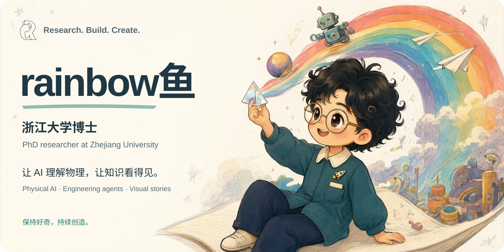</picture></a>

<strong>AI for the physical world. Knowledge you can see.</strong>

I am <strong>rainbow鱼</strong>, a <strong>PhD researcher at Zhejiang University</strong>. I build at the intersection of physical AI, engineering agents and scientific storytelling.

<a href="https://rainbowyuyu.github.io/rainbowyuyu/?lang=en"><picture><source media="(prefers-color-scheme: dark)" srcset="assets/readme/portfolio-en.svg"/><source media="(prefers-color-scheme: light)" srcset="assets/readme/portfolio-en-light.svg"/></picture></a>
<a href="#projects"><picture><source media="(prefers-color-scheme: dark)" srcset="assets/readme/projects-en.svg"/><source media="(prefers-color-scheme: light)" srcset="assets/readme/projects-en-light.svg"/></picture></a>
<a href="#activity"><picture><source media="(prefers-color-scheme: dark)" srcset="assets/readme/activity-en.svg"/><source media="(prefers-color-scheme: light)" srcset="assets/readme/activity-en-light.svg"/></picture></a>
<a href="https://space.bilibili.com/343585138"><picture><source media="(prefers-color-scheme: dark)" srcset="assets/readme/bilibili-en.svg"/><source media="(prefers-color-scheme: light)" srcset="assets/readme/bilibili-en-light.svg"/></picture></a>

<a href="assets/readme/ATTRIBUTION.md"><picture><source media="(prefers-color-scheme: dark)" srcset="assets/readme/typing.svg"/><source media="(prefers-color-scheme: light)" srcset="assets/readme/typing-light.svg"/></picture></a>

## A small toolbox, many possibilities

 &nbsp;
 &nbsp;
 &nbsp;
 &nbsp;
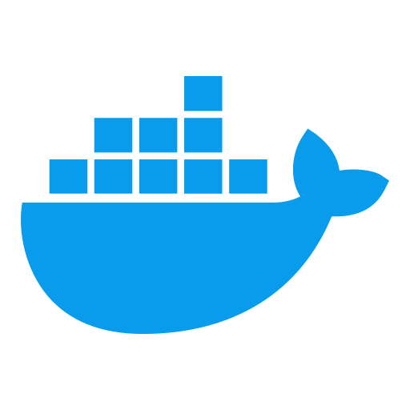 &nbsp;
 &nbsp;

Research · Simulation · Visual computing · Animation · Open source

## Selected work

Research platforms, engineering tools and visual stories. Each project keeps its own visual identity.

### PhysCast

<a href="https://rainbowyuyu.github.io/rainbowyuyu/?lang=en#physcast"><picture><source media="(prefers-color-scheme: dark)" srcset="assets/showcase/physcast.webp"/><source media="(prefers-color-scheme: light)" srcset="assets/showcase/physcast-light.webp"/>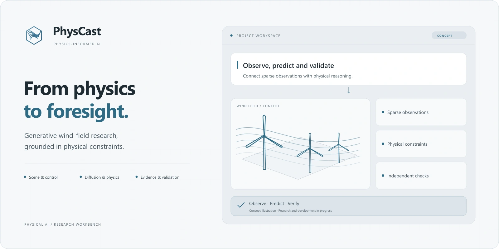</picture></a>

**Generative wind forecasting, grounded in physics**

Connecting OpenFAST / FAST.Farm, conditional diffusion and independent validation to study wind fields under sparse observations and control interventions.

RESEARCH IN PROGRESS · PRIVATE SOURCE

<a href="https://rainbowyuyu.github.io/rainbowyuyu/?lang=en#physcast"><picture><source media="(prefers-color-scheme: dark)" srcset="assets/readme/physcast-en.svg"/><source media="(prefers-color-scheme: light)" srcset="assets/readme/physcast-en-light.svg"/></picture></a>

### OmniForge

<a href="https://rainbowyuyu.github.io/rainbowyuyu/?lang=en#omniforge"><picture><source media="(prefers-color-scheme: dark)" srcset="assets/showcase/omniforge.webp"/><source media="(prefers-color-scheme: light)" srcset="assets/showcase/omniforge-light.webp"/>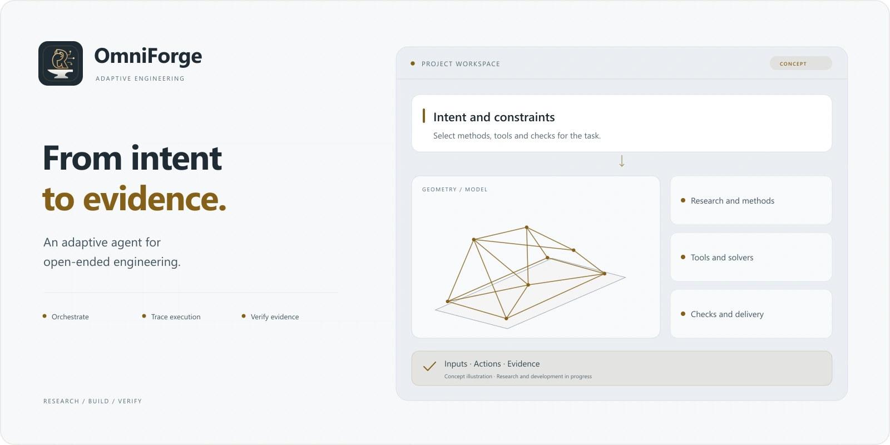</picture></a>

**From engineering intent to an inspectable workflow**

A workspace for planning, tool orchestration, modeling, finite elements and topology optimization—with inspectable execution and design evidence.

IN DEVELOPMENT · PRIVATE SOURCE

<a href="https://rainbowyuyu.github.io/rainbowyuyu/?lang=en#omniforge"><picture><source media="(prefers-color-scheme: dark)" srcset="assets/readme/omniforge-en.svg"/><source media="(prefers-color-scheme: light)" srcset="assets/readme/omniforge-en-light.svg"/></picture></a>

### Wiscomper

<a href="https://rainbowyuyu.github.io/rainbowyuyu/?lang=en#wiscomper"><picture><source media="(prefers-color-scheme: dark)" srcset="assets/showcase/wiscomper.webp"/><source media="(prefers-color-scheme: light)" srcset="assets/showcase/wiscomper-light.webp"/>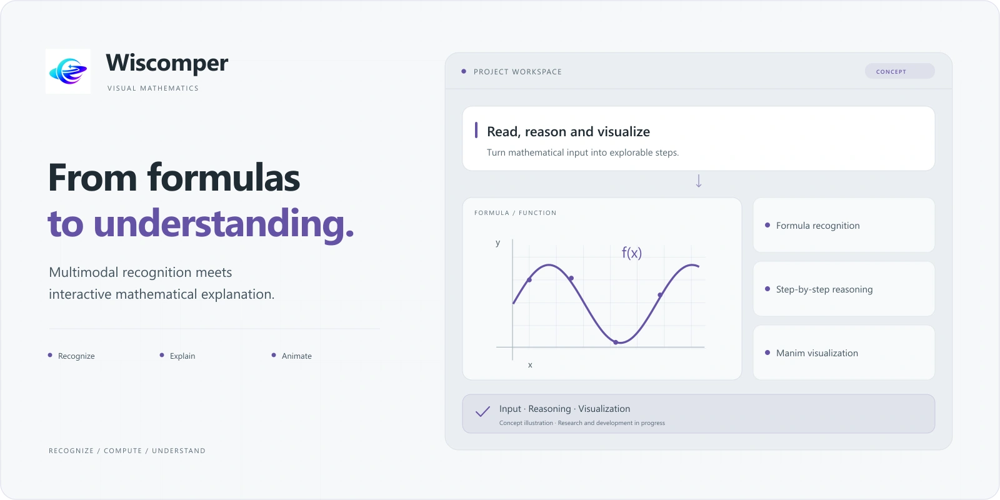</picture></a>

**From a formula to mathematics you can see**

Connecting formula recognition, LaTeX, worked solutions and Manim animation in an interactive mathematics workspace.

OPEN SOURCE · LIVE DEMO

<a href="https://www.wiscomper.com/"><picture><source media="(prefers-color-scheme: dark)" srcset="assets/readme/wiscomper-en.svg"/><source media="(prefers-color-scheme: light)" srcset="assets/readme/wiscomper-en-light.svg"/></picture></a>
<a href="https://github.com/rainbowyuyu/Wisdom_Computing_Perspective"><picture><source media="(prefers-color-scheme: dark)" srcset="assets/readme/github-en.svg"/><source media="(prefers-color-scheme: light)" srcset="assets/readme/github-en-light.svg"/></picture></a>

### The AI Engineer

<a href="https://rainbowyuyu.github.io/rainbowyuyu/?lang=en#ai-engineer"><picture><source media="(prefers-color-scheme: dark)" srcset="assets/showcase/ai-engineer.webp"/><source media="(prefers-color-scheme: light)" srcset="assets/showcase/ai-engineer-light.webp"/>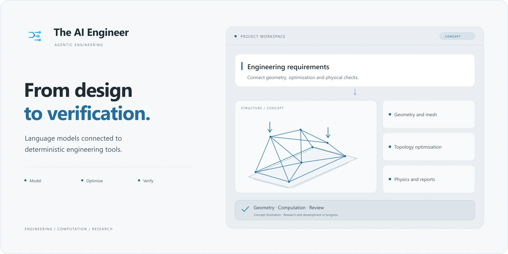</picture></a>

**Design. Compute. Inspect. Iterate.**

Connecting language models with deterministic engineering backends, from geometry and meshing to topology, sizing and design reports.

RESEARCH CODE · OPEN SOURCE

<a href="https://github.com/rainbowyuyu/ai_engineer"><picture><source media="(prefers-color-scheme: dark)" srcset="assets/readme/ai-engineer-en.svg"/><source media="(prefers-color-scheme: light)" srcset="assets/readme/ai-engineer-en-light.svg"/></picture></a>

### The Evolution of AI

<a href="https://rainbowyuyu.github.io/rainbowyuyu/?lang=en#ai-revolution"><picture><source media="(prefers-color-scheme: dark)" srcset="assets/showcase/ai-revolution.webp"/><source media="(prefers-color-scheme: light)" srcset="assets/showcase/ai-revolution-light.webp"/>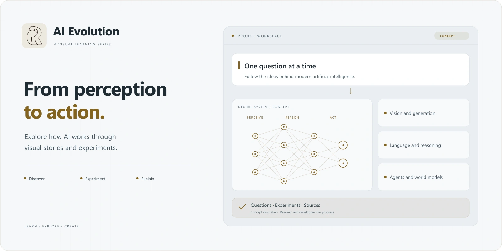</picture></a>

**A visual journey through the evolution of AI**

Exploring vision, generative models, language, multimodality and spatial reconstruction through animation and experiments. The agents and world-models chapter is planned.

ONGOING SERIES · OPEN SOURCE

<a href="https://rainbowyuyu.github.io/rainbowyuyu/?lang=en#ai-revolution"><picture><source media="(prefers-color-scheme: dark)" srcset="assets/readme/ai-revolution-en.svg"/><source media="(prefers-color-scheme: light)" srcset="assets/readme/ai-revolution-en-light.svg"/></picture></a>
<a href="https://github.com/rainbowyuyu/AI_revolution"><picture><source media="(prefers-color-scheme: dark)" srcset="assets/readme/github-en.svg"/><source media="(prefers-color-scheme: light)" srcset="assets/readme/github-en-light.svg"/></picture></a>

### rainbow鱼 · Science Studio

<a href="https://rainbowyuyu.github.io/rainbowyuyu/?lang=en#science-studio"><picture><source media="(prefers-color-scheme: dark)" srcset="assets/showcase/science-studio.webp"/><source media="(prefers-color-scheme: light)" srcset="assets/showcase/science-studio-light.webp"/>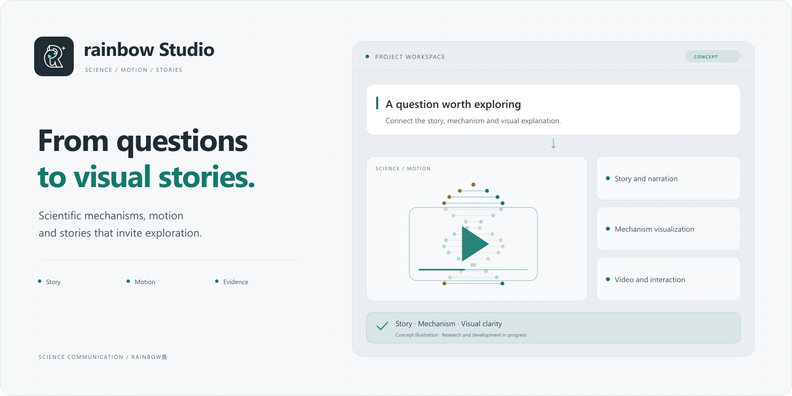</picture></a>

**Turning science questions into stories worth exploring**

A production workflow for stories, mechanism visualization, camera motion, captions and AI video editing, making research and engineering easier to understand.

ONGOING CREATION · OPEN SOURCE

<a href="https://space.bilibili.com/343585138"><picture><source media="(prefers-color-scheme: dark)" srcset="assets/readme/science-studio-en.svg"/><source media="(prefers-color-scheme: light)" srcset="assets/readme/science-studio-en-light.svg"/></picture></a>
<a href="https://github.com/rainbowyuyu/Popula_science_video"><picture><source media="(prefers-color-scheme: dark)" srcset="assets/readme/github-en.svg"/><source media="(prefers-color-scheme: light)" srcset="assets/readme/github-en-light.svg"/></picture></a>

### Manim Extend Rainbow

<a href="https://rainbowyuyu.github.io/rainbowyuyu/?lang=en#manim"><picture><source media="(prefers-color-scheme: dark)" srcset="assets/showcase/manim.webp"/><source media="(prefers-color-scheme: light)" srcset="assets/showcase/manim-light.webp"/>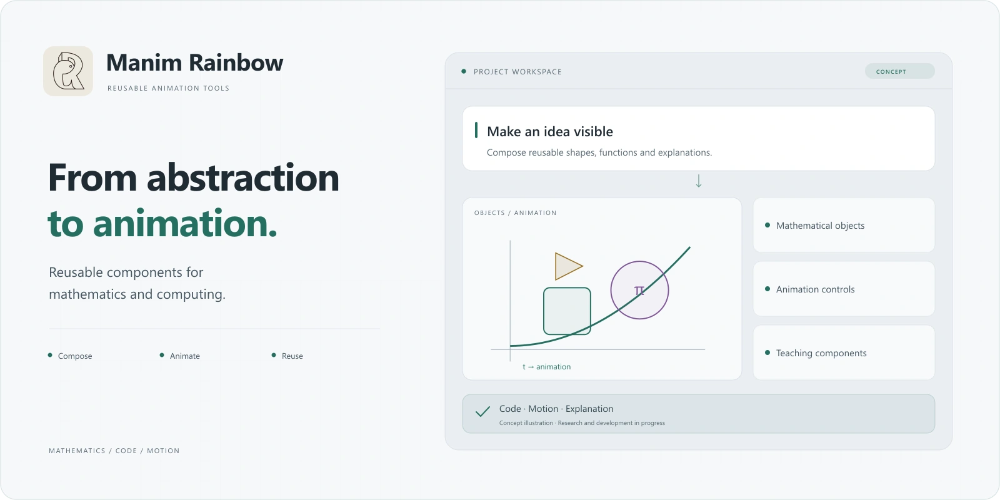</picture></a>

**Giving algorithms and structures a visual language**

Reusable Manim components for teaching data structures, operating systems and computer organization.

ANIMATION COMPONENTS · OPEN SOURCE

<a href="https://github.com/rainbowyuyu/manim_extend_rainbow"><picture><source media="(prefers-color-scheme: dark)" srcset="assets/readme/manim-en.svg"/><source media="(prefers-color-scheme: light)" srcset="assets/readme/manim-en-light.svg"/></picture></a>

Project descriptions updated 2026-10-27. Research and development remain ongoing; functionality and validation scope follow each project’s documentation.

## Built, day by day

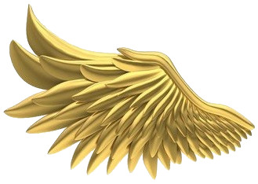 &nbsp; <picture><source media="(prefers-color-scheme: dark)" srcset="github-metrics/streak-dark.svg"/><source media="(prefers-color-scheme: light)" srcset="github-metrics/streak-light.svg"/>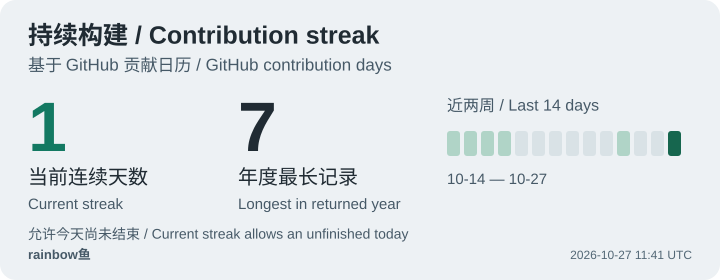</picture> &nbsp; 

<picture><source media="(prefers-color-scheme: dark)" srcset="profile-snake-contrib/github-contribution-grid-snake-dark.svg"/></picture>

<picture><source media="(prefers-color-scheme: dark)" srcset="github-metrics/base-dark.svg"/><source media="(prefers-color-scheme: light)" srcset="github-metrics/base-light.svg"/>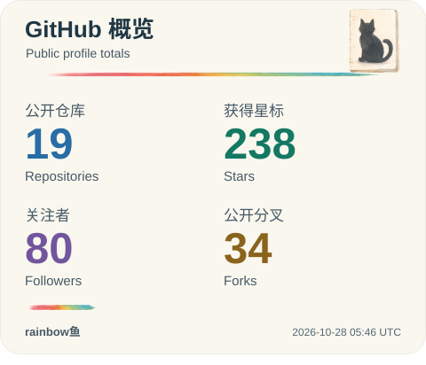</picture> <picture><source media="(prefers-color-scheme: dark)" srcset="github-metrics/languages.indepth-dark.svg"/><source media="(prefers-color-scheme: light)" srcset="github-metrics/languages.indepth-light.svg"/>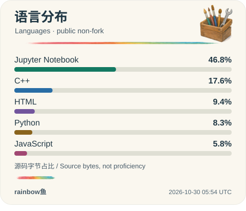</picture>

<picture><source media="(prefers-color-scheme: dark)" srcset="github-metrics/habits.charts-dark.svg"/><source media="(prefers-color-scheme: light)" srcset="github-metrics/habits.charts-light.svg"/>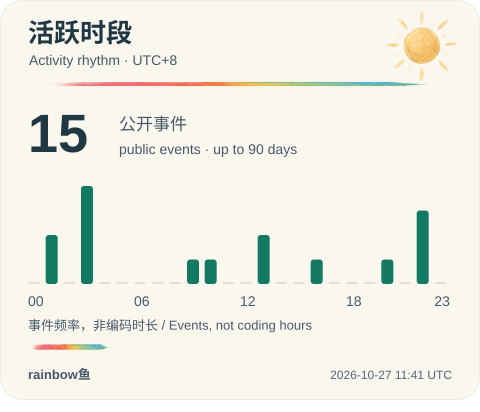</picture> <picture><source media="(prefers-color-scheme: dark)" srcset="github-metrics/wakatime-dark.svg"/><source media="(prefers-color-scheme: light)" srcset="github-metrics/wakatime-light.svg"/>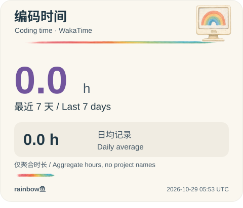</picture>

<picture><source media="(prefers-color-scheme: dark)" srcset="profile-3d-contrib/profile-night-rainbow.svg"/></picture>

<strong>More daily activity & archived cards</strong>

<picture><source media="(prefers-color-scheme: dark)" srcset="github-metrics/calendar.full-dark.svg"/><source media="(prefers-color-scheme: light)" srcset="github-metrics/calendar.full-light.svg"/>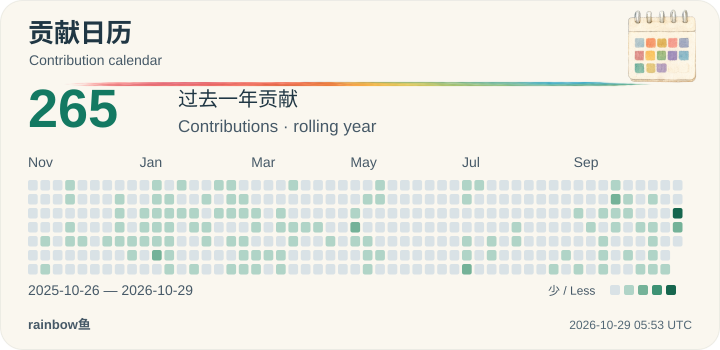</picture>

<picture><source media="(prefers-color-scheme: dark)" srcset="github-metrics/activity-dark.svg"/><source media="(prefers-color-scheme: light)" srcset="github-metrics/activity-light.svg"/>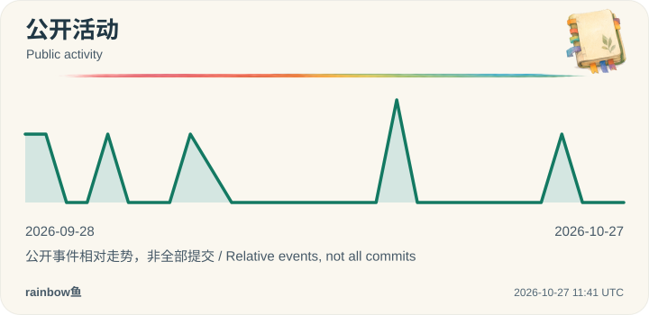</picture>

The following isometric calendar is an archived snapshot.

<picture><source media="(prefers-color-scheme: dark)" srcset="github-metrics/isocalendar.fullyear-dark.svg"/><source media="(prefers-color-scheme: light)" srcset="github-metrics/isocalendar.fullyear-light.svg"/></picture>

The scheduled jobs refresh the stored cards daily. WakaTime reflects measured activity over the last seven days. Use each card’s timestamp and the update status to assess freshness; unavailable providers keep the last successful snapshot.

[ Update status ](assets/profile/activity-status.json) &nbsp; · &nbsp; [ GitHub Actions ](https://github.com/rainbowyuyu/rainbowyuyu/actions) &nbsp; · &nbsp; [ All repositories ](https://github.com/rainbowyuyu?tab=repositories)

<picture><source media="(prefers-color-scheme: dark)" srcset="assets/readme/footer.svg"/><source media="(prefers-color-scheme: light)" srcset="assets/readme/footer-light.svg"/></picture>

<a href="https://rainbowyuyu.github.io/rainbowyuyu/?lang=en">Portfolio</a> &nbsp; · &nbsp; <a href="https://space.bilibili.com/343585138">Bilibili</a> &nbsp; · &nbsp; <a href="https://www.wiscomper.com/">Wiscomper</a> &nbsp; · &nbsp; <a href="assets/readme/ATTRIBUTION.md">Widget credits</a>

