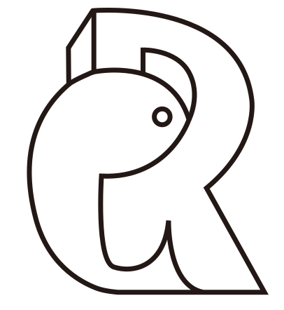
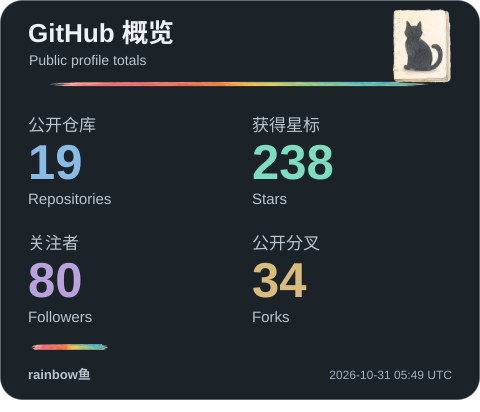
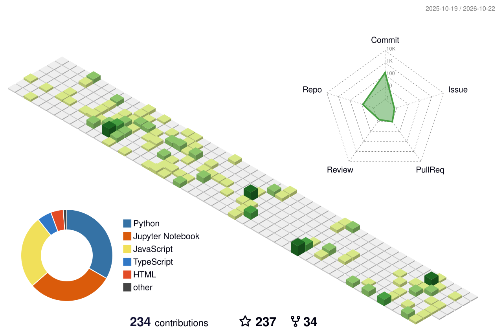
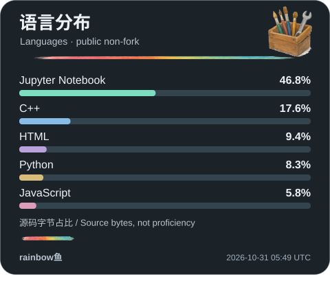
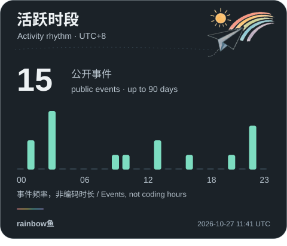
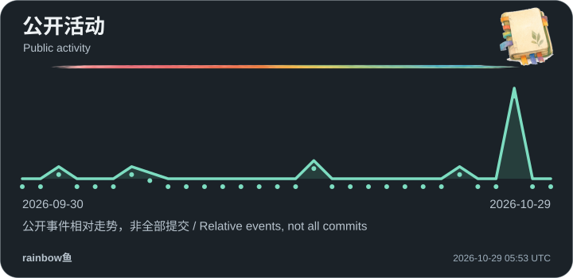
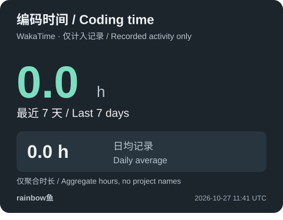

<a href="README.md">简体中文</a> &nbsp; / &nbsp; <strong>English</strong>

<h1 align="center">rainbow鱼</h1>

<strong>PhD researcher at Zhejiang University</strong>

Exploring physical AI. Building engineering tools. Making knowledge visible.

<a href="https://rainbowyuyu.github.io/rainbowyuyu/?lang=en"><kbd>PORTFOLIO ↗</kbd></a> &nbsp; <a href="#projects"><kbd>PROJECTS ↓</kbd></a> &nbsp; <a href="#activity"><kbd>ACTIVITY ↓</kbd></a> &nbsp; <a href="https://space.bilibili.com/343585138"><kbd>BILIBILI ↗</kbd></a>

## About

I am **rainbow鱼**, a PhD researcher at Zhejiang University. I build tools at the intersection of AI, physical simulation and engineering, and explain complex ideas through interactive visualization and animation.

My current focus is **PhysCast, OmniForge and Wiscomper**: predicting physical systems, coordinating engineering tools and making mathematical reasoning easier to explore.

## Project directory

One project per row. Expand a row for its introduction and links.

 &nbsp; <strong>PhysCast</strong> &nbsp; — &nbsp; Physics-informed generative wind-field forecasting

**Research in progress · Private source**

Connecting OpenFAST / FAST.Farm simulation, conditional diffusion and independent validation to study wind fields under sparse observations and control interventions.

[Introduction ↗](https://rainbowyuyu.github.io/rainbowyuyu/?lang=en#physcast)

 &nbsp; <strong>OmniForge · 万象工坊</strong> &nbsp; — &nbsp; Engineering workflows with inspectable inputs and results

**Active development · Private source**

Bringing planning, tool coordination, modeling, finite elements and topology optimization into one workspace with execution records and design evidence.

[Introduction ↗](https://rainbowyuyu.github.io/rainbowyuyu/?lang=en#omniforge)

 &nbsp; <strong>Wiscomper · 智算视界</strong> &nbsp; — &nbsp; From handwritten formulas to step-by-step animation

**Open source · Web experience**

Connecting formula images and text with LaTeX, solution steps and Manim animation, with an interactive workspace for editing and exploring mathematics.

[Introduction ↗](https://rainbowyuyu.github.io/rainbowyuyu/?lang=en#wiscomper) &nbsp; · &nbsp; [Explore ↗](https://www.wiscomper.com/) &nbsp; · &nbsp; [Source ↗](https://github.com/rainbowyuyu/Wisdom_Computing_Perspective)

 &nbsp; <strong>The AI Engineer</strong> &nbsp; — &nbsp; Model, compute and verify engineering designs

**Research software · Open source**

Connecting language models with deterministic engineering backends across geometry, meshing, topology and sizing optimization, physics calculations and design reports.

[Introduction ↗](https://rainbowyuyu.github.io/rainbowyuyu/?lang=en#ai-engineer) &nbsp; · &nbsp; [Source ↗](https://github.com/rainbowyuyu/ai_engineer)

 &nbsp; <strong>AI Evolution</strong> &nbsp; — &nbsp; Understanding AI through visual explanations and experiments

**Learning series · Open source**

A six-chapter journey through vision, generative models, language, multimodal AI and spatial reconstruction. Materials for the first five chapters are organized; agents and world models are planned.

[Introduction ↗](https://rainbowyuyu.github.io/rainbowyuyu/?lang=en#ai-revolution) &nbsp; · &nbsp; [Source ↗](https://github.com/rainbowyuyu/AI_revolution)

 &nbsp; <strong>rainbow鱼 · Science Studio</strong> &nbsp; — &nbsp; Turning scientific questions into visual stories

**Ongoing creation · Open source**

Organizing narratives, mechanism visualization, continuous camera motion, captions and AI video editing to explain research and engineering through motion.

[Introduction ↗](https://rainbowyuyu.github.io/rainbowyuyu/?lang=en#science-studio) &nbsp; · &nbsp; [Explore ↗](https://space.bilibili.com/343585138) &nbsp; · &nbsp; [Source ↗](https://github.com/rainbowyuyu/Popula_science_video)

 &nbsp; <strong>Manim Extend Rainbow</strong> &nbsp; — &nbsp; Reusable animations for computer science

**Animation components · Open source**

Extending Manim with reusable components for data structures, operating systems and computer organization.

[Introduction ↗](https://rainbowyuyu.github.io/rainbowyuyu/?lang=en#manim) &nbsp; · &nbsp; [Source ↗](https://github.com/rainbowyuyu/manim_extend_rainbow)

Updated 2026-10-27. Research and development continue; project documentation defines the available capabilities and validation scope.

## Activity observatory

Contribution animations and daily cards stay here. Generated assets are stored in this repository, so the profile does not depend on a live third-party image endpoint. Some data sources may update later than others.

<picture>
  <source media="(prefers-color-scheme: dark)" srcset="profile-snake-contrib/github-contribution-grid-snake-dark.svg"/>
  
</picture>

<strong>3D contribution landscape</strong>

<picture>
  <source media="(prefers-color-scheme: dark)" srcset="profile-3d-contrib/profile-night-rainbow.svg"/>
  
</picture>

<strong>Contribution calendar</strong>

The isometric calendar is retained as a historical snapshot; its generation record determines its date.

<strong>Languages &amp; coding habits</strong>

<strong>WakaTime · Coding time</strong>

The WakaTime card shows coding activity collected from the source for the past 7 days. Check its timestamp and [update status](assets/profile/activity-status.json) for freshness. Failed refreshes preserve the previous result; a zero-hour value in an older card does not establish current coding time.

[Update status](assets/profile/activity-status.json) &nbsp; · &nbsp; [Workflows](https://github.com/rainbowyuyu/rainbowyuyu/actions) &nbsp; · &nbsp; [All repositories](https://github.com/rainbowyuyu?tab=repositories)

## Toolkit

**Research** &nbsp; Python · PyTorch · MATLAB · OpenFAST / FAST.Farm · LaTeX 
**Visual computing** &nbsp; TypeScript · React · Three.js · Manim · Remotion · Blender 
**Engineering** &nbsp; Git · Docker · AI agents · Reproducible workflows

---

<strong>Stay curious. Keep building.</strong>

<a href="https://github.com/rainbowyuyu">GitHub</a> · <a href="https://space.bilibili.com/343585138">Bilibili</a> · <a href="https://www.wiscomper.com/">Wiscomper</a> · <a href="https://rainbowyuyu.github.io/rainbowyuyu/?lang=en">Portfolio</a>

