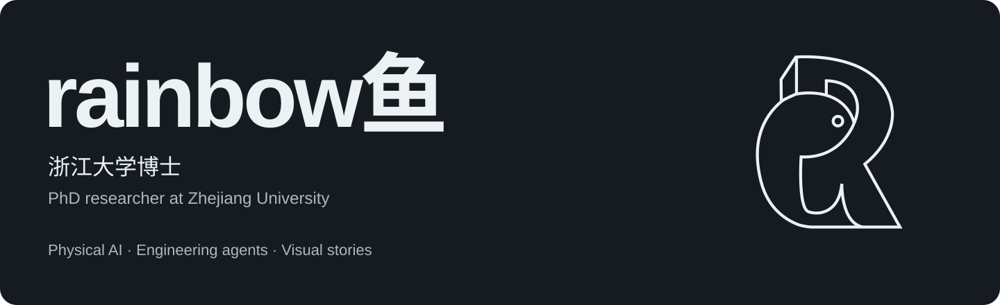
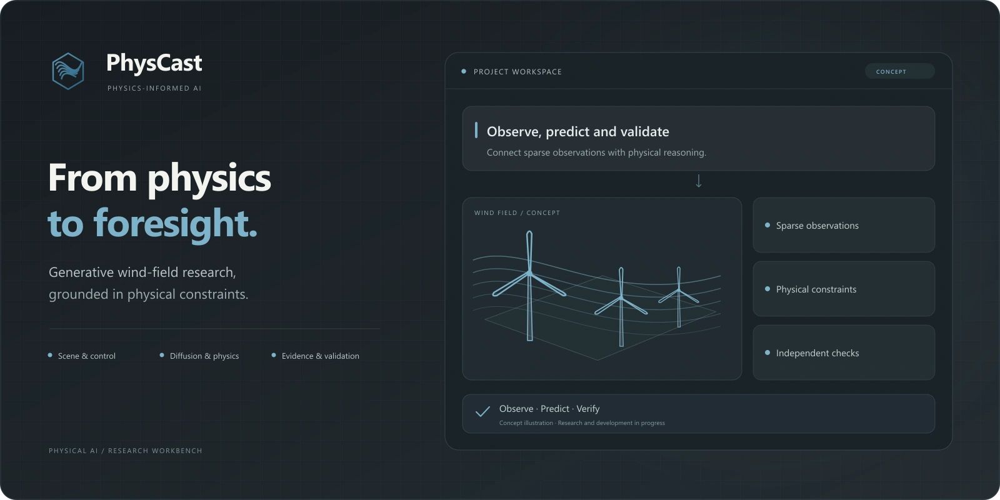
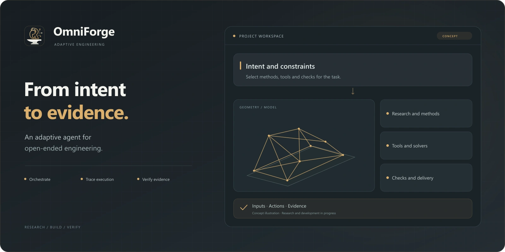
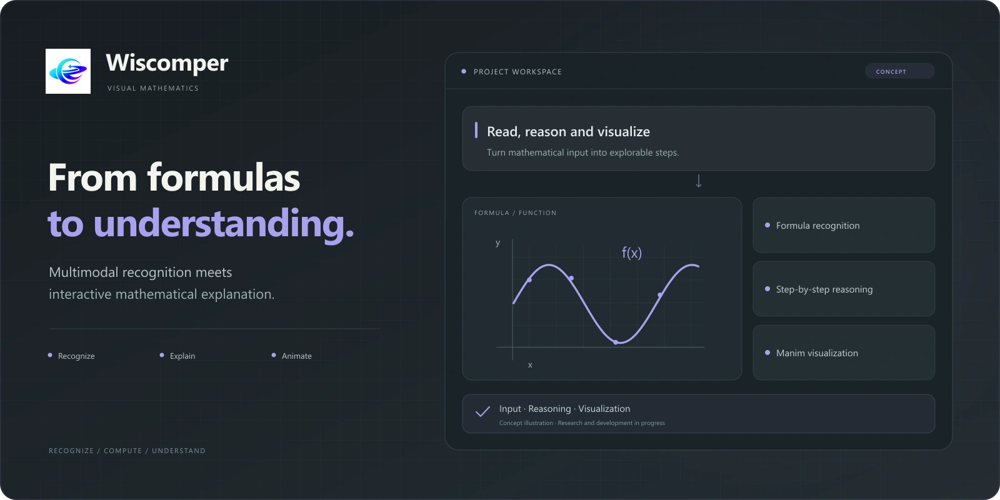
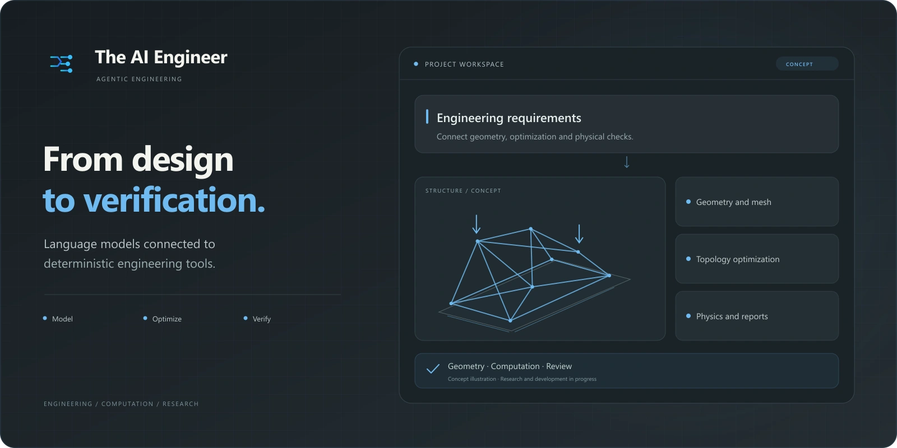
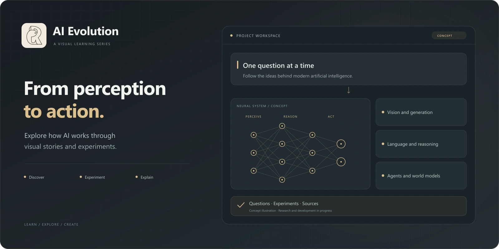
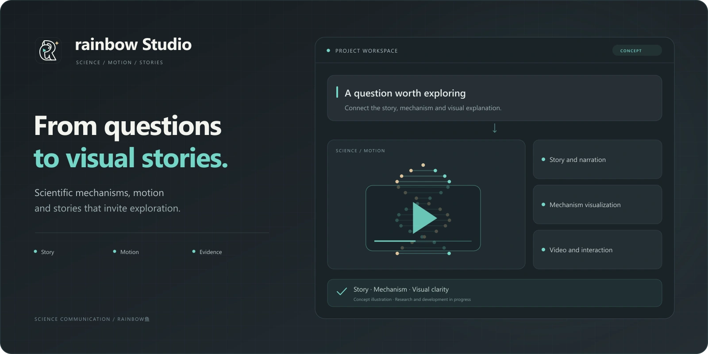
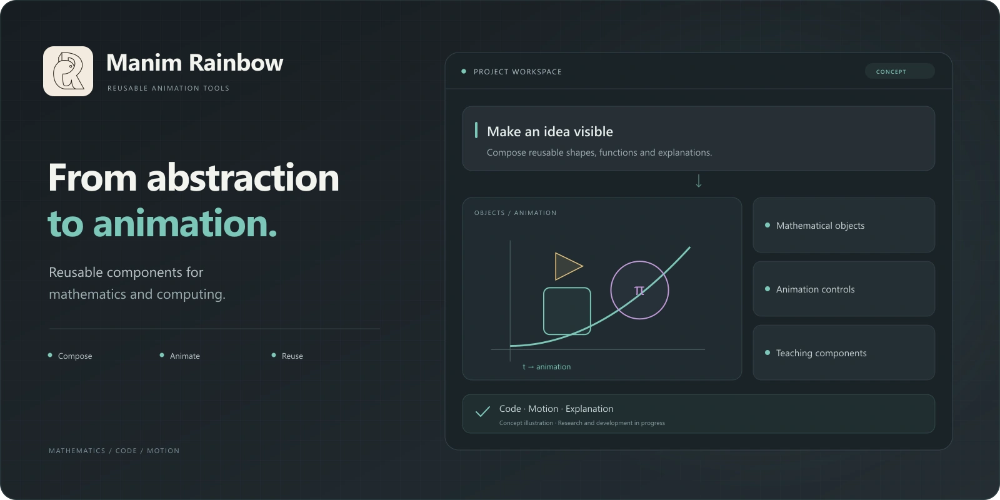
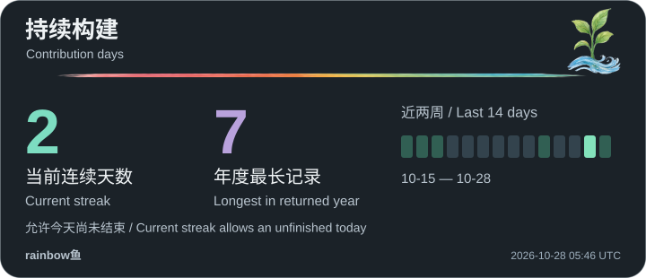

<!-- Generated by scripts/generate_readme.py. Edit the source copy and run Python to synchronize both languages. -->

<strong>简体中文</strong> &nbsp; / &nbsp; <a href="README.en.md">English</a>

<strong>让 AI 理解物理，让知识看得见。</strong>

我是 <strong>rainbow鱼</strong>，<strong>浙江大学博士</strong>。 在物理 AI、工程智能体与科学叙事之间，持续研究，也持续创造。

## 研究与创作工具箱

 &nbsp;
 &nbsp;
 &nbsp;
 &nbsp;
 &nbsp;
 &nbsp;

科研计算 · 物理仿真 · 交互可视化 · 动态影像 · 开源工具

## 精选项目

从研究平台到工程工具，再到科学影像。每个项目，保留自己的问题、色彩和表达。

### 01 / PhysCast

**物理约束的生成式风场预测**

连接 OpenFAST / FAST.Farm、条件扩散预测与独立验证，探索稀疏观测和控制干预下的风场变化。

研究中 · 源码私有

### 02 / OmniForge · 万象工坊

**让工程意图，走向可检查的设计过程**

把任务规划、工具协作、建模、有限元与拓扑优化组织在同一工作台，保留执行过程和设计依据。

持续开发 · 源码私有

### 03 / Wiscomper · 智算视界

**从一道公式，到一段看得懂的数学动画**

连接公式识别、LaTeX、解题步骤与 Manim 动画，在交互工作台里编辑、理解和探索数学。

开源 · 在线体验

### 04 / The AI Engineer

**设计之后，继续计算与验证**

将大模型与确定性的工程后端连接起来，串联几何、网格、拓扑优化、尺寸优化与设计报告。

研究代码 · 开源

### 05 / AI 进化史

**把 AI 的演进，讲成可以看见的故事**

用可视化、动画与实验梳理视觉、生成模型、语言、多模态与空间重建；智能体与世界模型章节规划中。

系列创作 · 开源

### 06 / rainbow鱼 · 科普工作台

**把科学问题，变成值得追问的画面**

将故事、机制可视化、连续运镜、字幕与 AI 视频编辑组织成创作流程，让研究与工程知识更容易理解。

持续创作 · 开源

### 07 / Manim Extend Rainbow

**让算法和结构，有直观的表达**

为数据结构、操作系统与计算机组成教学制作可复用的 Manim 扩展组件。

动画组件 · 开源

项目介绍更新于 2026-10-27。研究与开发持续进行，功能与验证范围以各项目文档为准。

## 日复一日，把想法做成作品

 &nbsp;  &nbsp; 

<picture><source media="(prefers-color-scheme: dark)" srcset="profile-snake-contrib/github-contribution-grid-snake-dark.svg"/></picture>

 

 

<picture><source media="(prefers-color-scheme: dark)" srcset="profile-3d-contrib/profile-night-rainbow.svg"/></picture>

<strong>展开更多每日活动与历史卡片</strong>

以下等距日历保留为历史快照。

每日任务自动更新本地卡片；WakaTime 展示最近 7 天真实记录。请以卡片时间与更新状态判断时效，数据源不可用时保留上次成功快照。

[ 更新状态 ](assets/profile/activity-status.json) &nbsp; · &nbsp; [ GitHub Actions ](https://github.com/rainbowyuyu/rainbowyuyu/actions) &nbsp; · &nbsp; [ 全部仓库 ](https://github.com/rainbowyuyu?tab=repositories)

<a href="https://rainbowyuyu.github.io/rainbowyuyu/">Portfolio</a> &nbsp; · &nbsp; <a href="https://space.bilibili.com/343585138">Bilibili</a> &nbsp; · &nbsp; <a href="https://www.wiscomper.com/">Wiscomper</a> &nbsp; · &nbsp; <a href="assets/readme/ATTRIBUTION.md">Widget credits</a>

