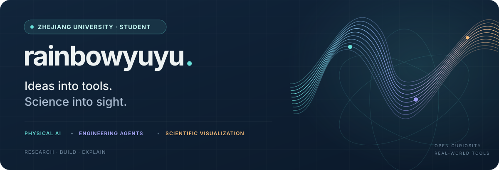
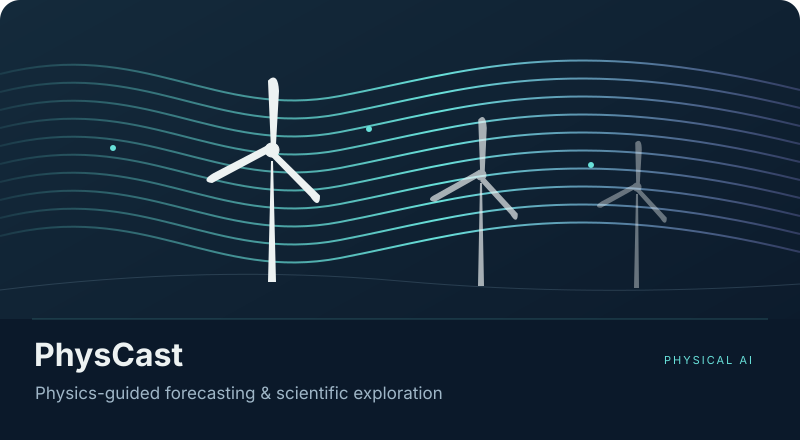
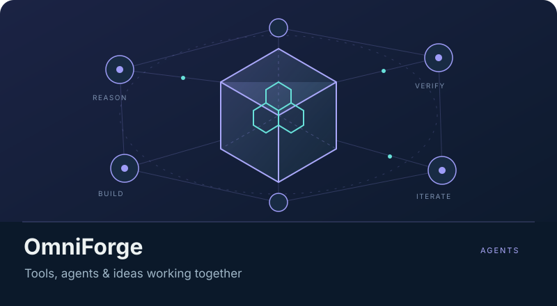
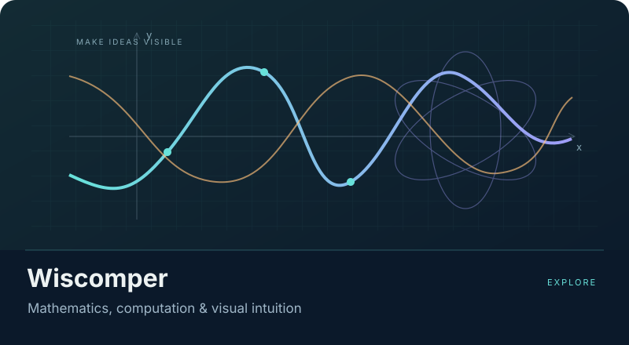
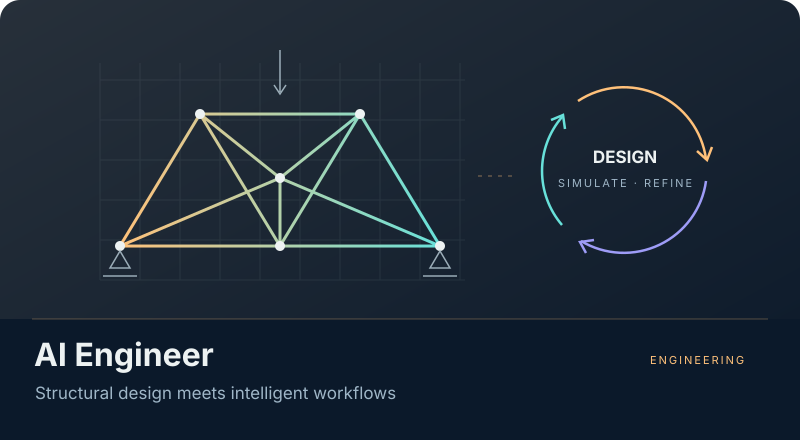

<h1 align="center">俞天翼 · rainbow鱼</h1>

<strong>浙江大学学生 · Student at Zhejiang University</strong>

让 AI 理解物理，让知识看得见。 Building at the intersection of physical AI, engineering agents & visual learning.

<a href="https://rainbowyuyu.github.io/rainbowyuyu/"><strong>个人主页 ↗</strong></a> &nbsp; · &nbsp; <a href="https://www.wiscomper.com/">Wiscomper ↗</a> &nbsp; · &nbsp; <a href="https://space.bilibili.com/343585138">Bilibili ↗</a> &nbsp; · &nbsp; <a href="#selected-work">精选项目 ↓</a>

---

### About / 我在做什么

我是浙江大学的学生 **俞天翼**，也以 **rainbow鱼 / rainbowyuyu** 分享作品。

我关心 AI 如何走进真实的物理与工程问题：从风场预测、物理仿真，到能建模、计算、检查结果的工程智能体。另一条长期主线，是把公式、算法和科学机制变成直观的交互与动画。

目前主要投入 **PhysCast、OmniForge 和 Wiscomper**：探索物理世界的预测，让工程工具协同工作，也让复杂知识更容易理解。

<table><tr>
<td width="33%" valign="top"><strong>01 / Physical AI</strong> 物理约束 · 生成式预测 · 风场仿真</td>
<td width="33%" valign="top"><strong>02 / Engineering Agents</strong> 多智能体协作 · 设计计算 · 验证闭环</td>
<td width="33%" valign="top"><strong>03 / Visual Learning</strong> 数学可视化 · 交互工具 · 科普影像</td>
</tr></table>

## Selected work / 近期重点

<table>
<tr>
<td width="50%" valign="top">

<h3>PhysCast</h3>

<strong>让预测遵循物理。</strong>

连接三维风场场景、OpenFAST / FAST.Farm 仿真与条件扩散预测，研究稀疏观测下的风场重建、控制干预与预测可信性。

Physical AI · Diffusion · Wind Energy

<strong>研究中</strong> · 源码暂不公开

</td>
<td width="50%" valign="top">

<h3>OmniForge · 万象工场</h3>

<strong>从一个想法，到可检查的工程结果。</strong>

把自然语言需求、智能体协作、可视化建模、有限元与拓扑优化连接在同一工作台，保留执行轨迹与设计依据。

Agent Orchestration · Simulation · Engineering

<strong>持续开发</strong> · 源码暂不公开

</td>
</tr>
<tr>
<td valign="top">

<h3>Wiscomper · 智算视界</h3>

<strong>把一道公式，变成看得懂的过程。</strong>

从手写公式与文本识别，到 LaTeX、解题步骤、Manim 脚本与分阶段动画，连接数学理解、可视化与交互编辑。

Math · Multimodal AI · Manim · Visual Learning

<a href="https://www.wiscomper.com/"><strong>体验网站 ↗</strong></a> · <a href="https://github.com/rainbowyuyu/Wisdom_Computing_Perspective">GitHub ↗</a>

</td>
<td valign="top">

<h3>The AI Engineer</h3>

<strong>设计之后，还要计算与验证。</strong>

把大模型与确定性的工程后端连接起来，串联几何、网格、拓扑与尺寸优化、物理计算和设计报告。

Engineering AI · Topology Optimization · Verification

<a href="https://github.com/rainbowyuyu/ai_engineer"><strong>探索项目 ↗</strong></a>

</td>
</tr>
</table>

项目状态更新于 2026-10-27。研究与开发持续进行；项目介绍不代表已发表论文、已授权专利或已完成实机验证。

## Make knowledge visible / 也在创作

| 项目 | 我在做的事 | 入口 |
| :--- | :--- | :--- |
| **rainbow鱼 · AI 进化史** | 用可视化教学与可复现实验，串起视觉、生成模型、语言、多模态与空间重建；智能体与世界模型章节规划中。 | [AI_revolution ↗](https://github.com/rainbowyuyu/AI_revolution) |
| **rainbow鱼 · 科普影像** | 从故事与机制出发，连接科学可视化、连续运镜、字幕与 AI 视频编辑工作台。 | [科普工作台 ↗](https://github.com/rainbowyuyu/Popula_science_video) |
| **Manim Extend Rainbow** | 为数据结构、操作系统与计算机组成教学制作可复用动画组件。 | [Manim 扩展 ↗](https://github.com/rainbowyuyu/manim_extend_rainbow) |

### Toolkit / 常用工具

**研究与计算** &nbsp; Python · PyTorch · MATLAB · OpenFAST / FAST.Farm · LaTeX 
**交互与可视化** &nbsp; TypeScript · React · Three.js · Manim · Remotion · Blender 
**构建与协作** &nbsp; Git · Docker · AI agents · Reproducible workflows

---

<strong>保持好奇，把想法做成作品。</strong> Open to conversations about physical AI, engineering tools & science communication.

<a href="https://github.com/rainbowyuyu">GitHub</a> · <a href="https://space.bilibili.com/343585138">Bilibili</a> · <a href="https://rainbowyuyu.github.io/rainbowyuyu/">Portfolio</a>

